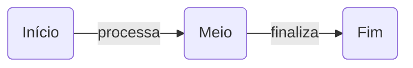

# mermaid-draw

Editor de diagramas [Mermaid](https://mermaid.js.org/) minimalista, focado em **lazy loading**: o diagrama é carregado e renderizado de forma dinâmica, sob demanda, à medida que você edita.

> 🚧 Projeto em estágio inicial.

## Ideia

A maioria dos editores Mermaid carrega a biblioteca inteira de uma vez e re-renderiza todo o diagrama a cada tecla. O `mermaid-draw` segue outro caminho:

- **Mermaid sob demanda** — a biblioteca só é importada (`import()` dinâmico) quando há algo para desenhar.
- **Renderização dinâmica** — o diagrama é atualizado conforme você edita, sem recarregar a página.
- **Escopo pequeno de propósito** — apenas dois componentes, para manter o editor leve e previsível.

## Componentes

O editor suporta somente dois elementos:

| Componente | Descrição | Sintaxe Mermaid |
|---|---|---|
| **Retângulo** | Caixa com cantos arredondados e um texto | `A(Texto do retângulo)` |
| **Seta** | Ligação entre dois retângulos, com um texto | `A -->\|texto da seta\| B` |

### Exemplo

## Roadmap

- [ ] Editor de texto com preview ao vivo
- [ ] Carregamento lazy do Mermaid
- [ ] Retângulo arredondado com texto
- [ ] Seta com texto
- [ ] Exportar SVG/PNG

## Licença

MIT
