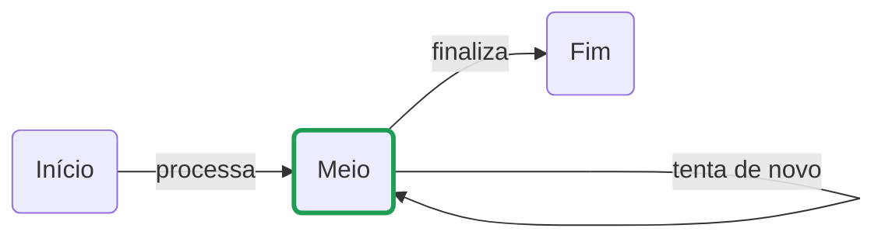

# mermaid-draw

Editor visual de diagramas [Mermaid](https://mermaid.js.org/), minimalista, com drag and drop. Você desenha no canvas e o código Mermaid é gerado ao lado; edita o código e o desenho acompanha. O status dos retângulos pode ser controlado de fora, via `curl`.

> 🚧 Projeto em estágio inicial. O objetivo final é ser um editor focado em **lazy loading** do Mermaid (ver [Roadmap](#roadmap)); por enquanto o Mermaid é carregado junto com a página.

## Componentes

O editor tem só dois elementos, de propósito:

| Componente | Descrição | Sintaxe Mermaid |
|---|---|---|
| **Retângulo** | Caixa com cantos arredondados e um texto. Pode estar **ativo** (borda verde) ou inativo. | `n1("Texto")` |
| **Seta** | Liga dois retângulos, com um texto opcional. Pode ligar um retângulo a ele mesmo (ciclo). | `n1 -->\|"texto"\| n2` |

### Exemplo



## Como usar

```bash
npm install
npm run dev
```

Abra o endereço que o Vite mostrar (normalmente http://localhost:5173; se a porta estiver ocupada, ele usa a próxima).

| Ação | Como fazer |
|---|---|
| Criar retângulo | Arraste "Retângulo" da paleta para o canvas, clique nele na paleta ou dê duplo clique no canvas vazio |
| Criar seta | Arraste a bolinha azul na lateral de um retângulo até outro, ou solte "Seta" da paleta sobre o retângulo de origem e clique no destino |
| Modo seta | Clique em "Seta" na paleta: arrastar a partir de qualquer retângulo cria setas. `Esc` sai do modo |
| Criar ciclo | Arraste a bolinha para fora e volte ao mesmo retângulo, ou solte "Seta" sobre ele e clique nele mesmo |
| Editar texto | Duplo clique no retângulo ou na seta. `Enter` confirma, `Esc` cancela |
| Ativar/inativar | Clique na bolinha à esquerda do retângulo, ou selecione e aperte `A` |
| Mover | Arraste o retângulo |
| Remover | Selecione e aperte `Delete` |

O painel da direita mostra o código Mermaid, que pode ser editado, e um preview renderizado pelo próprio Mermaid. O preview usa o layout automático do Mermaid, não as posições do canvas.

### Como o diagrama é salvo

- **Status ativo:** vira uma classe Mermaid: `classDef ativo stroke:#1f9d55,stroke-width:3px` e `class n1,n2 ativo`.
- **Posições:** ficam em comentários `%% @pos id x y`, que o Mermaid ignora. Assim o código sozinho reconstrói o desenho.
- **Persistência:** com o servidor rodando, o diagrama fica em `diagram.mmd` (fora do git), compartilhado por todas as abas abertas. Uma cópia também fica no `localStorage` do navegador, usada quando a API não está disponível.

## API (curl)

O servidor do Vite (`npm run dev` ou `npm run preview`) expõe uma API em `/api`. Toda mudança feita pela API aparece na hora nos navegadores abertos. Nas rotas, `:ref` é o id (`n1`) ou o texto do retângulo (sem diferenciar maiúsculas).

```bash
# ativar, desativar ou alternar um retângulo
curl -X POST localhost:5173/api/nodes/n1/ativar
curl -X POST localhost:5173/api/nodes/Meio/desativar
curl -X POST localhost:5173/api/nodes/n1/alternar

# consultar
curl localhost:5173/api/nodes
curl localhost:5173/api/nodes/n1
curl localhost:5173/api/diagram

# substituir o diagrama inteiro
curl -X PUT --data-binary @meu-diagrama.mmd localhost:5173/api/diagram
```

| Método | Rota | O que faz |
|---|---|---|
| `GET` | `/api/diagram` | Código Mermaid atual (`204` se ainda não há diagrama) |
| `PUT` | `/api/diagram` | Substitui o código (corpo em texto; `400` se houver linhas inválidas) |
| `GET` | `/api/nodes` | Lista os retângulos com `id`, `text` e `active` |
| `GET` | `/api/nodes/:ref` | Um retângulo |
| `POST` | `/api/nodes/:ref/ativar` | Ativa |
| `POST` | `/api/nodes/:ref/desativar` | Desativa |
| `POST` | `/api/nodes/:ref/alternar` | Inverte o status |
| `GET` | `/api/events` | Server-Sent Events com o código a cada mudança |

Respostas de erro: `404` quando o retângulo não existe e `409` quando mais de um retângulo tem o mesmo texto (use o id).

Exemplo de resposta:

```json
{ "id": "n1", "text": "Início", "active": true }
```

### Variáveis de ambiente

| Variável | Para quê |
|---|---|
| `MERMAID_DRAW_FILE` | Arquivo onde a API guarda o diagrama (padrão: `diagram.mmd` na raiz do projeto) |

No WSL, o Vite usa polling automaticamente para perceber mudanças em arquivos de `/mnt/c`.

## Estrutura

```
index.html         layout da página
src/model.ts       modelo do diagrama, geração e leitura do código Mermaid
src/store.ts       estado (diagrama, seleção, modo) e notificações de mudança
src/canvas.ts      canvas SVG: drag and drop, setas, ciclos, edição de texto
src/main.ts        paleta, painel de código, preview e sincronização com a API
src/style.css      estilos (tema claro e escuro)
server/api.ts      plugin do Vite com a API HTTP e os Server-Sent Events
```

## Roadmap

- [x] Canvas com drag and drop
- [x] Retângulo arredondado com texto
- [x] Seta com texto, incluindo ciclos
- [x] Código Mermaid sincronizado nos dois sentidos, com preview
- [x] Status ativo/inativo, também via API
- [ ] Carregamento lazy do Mermaid (`import()` dinâmico só quando há algo para desenhar)
- [ ] Exportar SVG/PNG

## Licença

MIT
