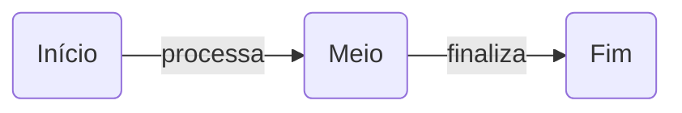

# mermaid-draw

Editor de diagramas [Mermaid](https://mermaid.js.org/) minimalista, focado em **lazy loading**: o diagrama é carregado e renderizado de forma dinâmica, sob demanda, à medida que você edita.

> 🚧 Projeto em estágio inicial: o editor com drag and drop já funciona; o lazy loading ainda não foi implementado.

## Ideia

A maioria dos editores Mermaid carrega a biblioteca inteira de uma vez e re-renderiza todo o diagrama a cada tecla. O `mermaid-draw` segue outro caminho:

- **Mermaid sob demanda** — a biblioteca só é importada (`import()` dinâmico) quando há algo para desenhar.
- **Renderização dinâmica** — o diagrama é atualizado conforme você edita, sem recarregar a página.
- **Escopo pequeno de propósito** — apenas dois componentes, para manter o editor leve e previsível.

## Componentes

O editor suporta somente dois elementos:

| Componente | Descrição | Sintaxe Mermaid |
|---|---|---|
| **Retângulo** | Caixa com cantos arredondados e um texto | `A(Texto do retângulo)` |
| **Seta** | Ligação entre dois retângulos, com um texto | `A -->\|texto da seta\| B` |

### Exemplo



## Como usar

```bash
npm install
npm run dev
```

- **Retângulo:** arraste da paleta para o canvas (ou clique nele, ou dê duplo clique no canvas vazio).
- **Seta:** arraste a bolinha azul na lateral de um retângulo até outro, ou solte a "Seta" da paleta sobre o retângulo de origem e clique no destino. Clicar em "Seta" ativa o modo seta. Para um ciclo, arraste a bolinha para fora e volte ao mesmo retângulo (ou solte a "Seta" nele e clique nele mesmo).
- **Texto:** duplo clique no retângulo ou na seta. `Enter` confirma, `Esc` cancela.
- **Mover:** arraste o retângulo.
- **Remover:** selecione e aperte `Delete`.
- **Ativo/inativo:** clique na bolinha à esquerda do retângulo (ou selecione e aperte `A`). Retângulos ativos ficam com a borda verde fixa.

O código Mermaid ao lado é atualizado enquanto você desenha, e editar o código também atualiza o canvas. As posições ficam em comentários `%% @pos id x y`, que o Mermaid ignora. O diagrama é salvo no `localStorage` do navegador.

## API (curl)

O servidor de desenvolvimento expõe uma API em `/api`. O diagrama fica salvo em `diagram.mmd` (ou no arquivo indicado em `MERMAID_DRAW_FILE`), e qualquer navegador aberto no editor é atualizado na hora. `:ref` é o id (`n1`) ou o texto do retângulo.

```bash
# ativar, desativar ou alternar um retângulo
curl -X POST localhost:5173/api/nodes/n1/ativar
curl -X POST localhost:5173/api/nodes/Meio/desativar
curl -X POST localhost:5173/api/nodes/n1/alternar

# consultar
curl localhost:5173/api/nodes
curl localhost:5173/api/nodes/n1
curl localhost:5173/api/diagram

# substituir o diagrama inteiro
curl -X PUT --data-binary @meu-diagrama.mmd localhost:5173/api/diagram
```

| Método | Rota | O que faz |
|---|---|---|
| `GET` | `/api/diagram` | Código Mermaid atual |
| `PUT` | `/api/diagram` | Substitui o código (corpo em texto) |
| `GET` | `/api/nodes` | Lista os retângulos com `id`, `text` e `active` |
| `GET` | `/api/nodes/:ref` | Um retângulo |
| `POST` | `/api/nodes/:ref/ativar` | Ativa |
| `POST` | `/api/nodes/:ref/desativar` | Desativa |
| `POST` | `/api/nodes/:ref/alternar` | Inverte o status |
| `GET` | `/api/events` | Server-Sent Events a cada mudança |

No código Mermaid, o status vira uma classe: `classDef ativo stroke:#1f9d55,stroke-width:3px` e `class n1,n2 ativo`.

## Roadmap

- [x] Canvas com drag and drop
- [x] Retângulo arredondado com texto
- [x] Seta com texto
- [x] Código Mermaid sincronizado nos dois sentidos, com preview
- [x] Status ativo/inativo, também via API
- [ ] Carregamento lazy do Mermaid
- [ ] Exportar SVG/PNG

## Licença

MIT
