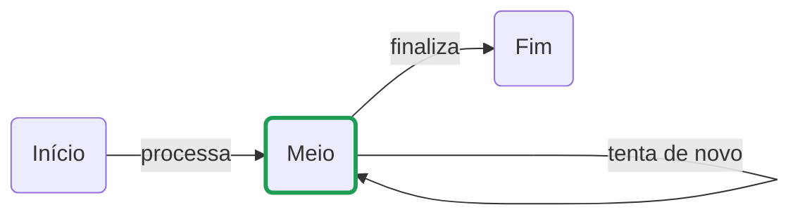

# mermaid-draw

Editor visual de diagramas [Mermaid](https://mermaid.js.org/), minimalista, com drag and drop e **fine-grained reactivity**: cada retângulo e cada seta é uma unidade independente, que pode ser criada, editada ou removida sozinha — pelo canvas ou via `curl` — sem reenviar nem redesenhar o diagrama inteiro.

> 🚧 Projeto em estágio inicial.

## O que é e o que não é

**É:**

- **Um editor visual de fluxogramas simples:** retângulos e setas arrastados num canvas, que viram código Mermaid limpo e legível, para colar num README, numa wiki ou no GitHub.
- **Um desenho com posições suas:** você coloca cada retângulo onde quiser, e as posições ficam no próprio código Mermaid (em comentários `%% @pos`). O código sozinho reconstrói o desenho.
- **Ida e volta entre código e canvas:** dá para editar o código no painel ao lado, e o canvas acompanha.
- **Controlável por API:** cada retângulo e cada seta é um recurso HTTP. Um script ou um `curl` pode criar, mudar o texto ou marcar uma etapa como ativa, e todas as abas abertas veem a mudança na hora.
- **Um acompanhamento leve de processos:** cada etapa pode estar ativa ou inativa e ter um responsável.
- **Vários diagramas:** o menu ☰ cria, renomeia, duplica, exporta, importa e apaga diagramas, e a busca encontra um pelo nome.
- **Comunicação visível entre etapas:** uma seta pode ficar animada, com o tracejado correndo, ou receber um "pulso", em que uma mensagem percorre a seta da origem até o destino. Um script pode mandar esses pulsos pela API para mostrar, ao vivo, algo passando de uma etapa para outra.
- **Uma ferramenta local:** roda com `npm run dev` e guarda cada diagrama numa pasta (`diagrams/<nome>/diagram.json`).

**Não é:**

- **Um editor completo de Mermaid.** Só entende `flowchart` com retângulos arredondados (`n1("texto")`) e setas `-->`, com texto opcional. Outros tipos de diagrama (sequência, classes, Gantt, ER…), outras formas, subgráficos e estilos livres não são suportados: o painel de código aponta essas linhas como não reconhecidas.
- **Um executor de fluxos.** O desenho não roda nada; o "ativo" é só uma marcação visual. Para cada retângulo virar um container Docker e cada seta um gatilho, existe o fork [mermaid-docker-draw](https://github.com/lucasisabelf/mermaid-docker-draw).
- **Um serviço para a internet.** Não há login, contas nem controle de acesso: qualquer um que alcance o servidor lê e altera o diagrama pela API. Use só na sua máquina ou numa rede confiável.
- **Colaboração com resolução de conflitos.** Várias abas ficam sincronizadas, mas, se duas pessoas mudarem o mesmo elemento ao mesmo tempo, vale a última mudança. Não há CRDT nem histórico de versões além do `rev`.
- **Um layout automático.** O canvas não reorganiza o desenho sozinho. O preview usa o layout próprio do Mermaid, que é independente das suas posições.
- **Um banco de diagramas compartilhado.** Os diagramas são pastas no disco do servidor, sem permissões por diagrama nem histórico de versões. Apagar só move a pasta para `diagrams/.removidos/`.
- **Pronto para produção.** A API vive dentro do servidor do Vite (`npm run dev` ou `npm run preview`): não existe um servidor separado para publicar.

## Fine-grained reactivity

Em vez de tratar o diagrama como um bloco de texto Mermaid que é reescrito a cada mudança, o `mermaid-draw` trata cada elemento como um recurso próprio:

- **Na API**, um `PATCH /api/nodes/n1` altera só o retângulo `n1`. O servidor guarda o estado estruturado (JSON) e gera o código Mermaid só quando alguém pede.
- **Na rede**, cada mudança vira um evento pequeno (`node.updated`, `edge.added`…) enviado por Server-Sent Events a todas as abas abertas. Arrastar um retângulo manda só `{x, y}` daquele retângulo.
- **No canvas**, cada evento redesenha só o elemento afetado. Mudar o texto ou o status de um retângulo recria só ele; as setas ligadas a ele só são redesenhadas quando ele muda de posição ou de largura.

O código Mermaid e o preview continuam disponíveis como **visões derivadas** do estado.

## Componentes

O editor tem só dois elementos, de propósito:

| Componente | Descrição | Sintaxe Mermaid |
|---|---|---|
| **Retângulo** | Caixa com cantos arredondados e um texto. Pode estar **ativo** (borda verde) ou inativo e ter um **responsável**: o nome de quem cuida daquela etapa. | `n1("Texto")` |
| **Seta** | Liga dois retângulos, com um texto opcional. Pode ligar um retângulo a ele mesmo (ciclo) e pode ser **animada**, com o tracejado correndo da origem para o destino. | `n1 -->\|"texto"\| n2` · animada: `n1 e1@--> n2` + `e1@{ animate: true }` |

### Exemplo



## Como usar

```bash
npm install
npm run dev
```

Abra o endereço que o Vite mostrar (normalmente http://localhost:5173; se a porta estiver ocupada, ele usa a próxima).

| Ação | Como fazer |
|---|---|
| Criar retângulo | Arraste "Retângulo" da paleta para o canvas, clique nele na paleta ou dê duplo clique no canvas vazio |
| Criar seta | Arraste a bolinha azul na lateral de um retângulo até outro, ou solte "Seta" da paleta sobre o retângulo de origem e clique no destino |
| Modo seta | Clique em "Seta" na paleta: arrastar a partir de qualquer retângulo cria setas. `Esc` sai do modo |
| Criar ciclo | Arraste a bolinha para fora e volte ao mesmo retângulo, ou solte "Seta" sobre ele e clique nele mesmo |
| Editar texto | Duplo clique no retângulo ou na seta. `Enter` confirma, `Esc` cancela |
| Ativar/inativar | Clique na bolinha à esquerda do retângulo, ou selecione e aperte `A` |
| Definir o responsável | Selecione o retângulo e clique em "+ responsável", ou aperte `R`. O nome aparece numa segunda linha dentro do retângulo, no canvas e no preview |
| Trocar ou remover o responsável | Duplo clique na linha do nome (ou `R`). Esvaziar o campo remove o responsável |
| Mover | Arraste o retângulo |
| Remover | Selecione e aperte `Delete` |
| Animar uma seta | Selecione a seta e aperte `M`. O tracejado passa a correr de origem para destino, no canvas e no preview |
| Mandar uma mensagem pela seta | Selecione a seta e aperte `P`: uma mensagem percorre a seta e o destino dá um pulso, em todas as abas abertas |
| Trocar de diagrama | Botão **☰** ao lado do título (veja [Vários diagramas](#vários-diagramas)) |
| Exportar | "Exportar SVG" ou "Exportar PNG" na barra de cima |

O painel da direita mostra o código Mermaid, que pode ser editado, e um preview renderizado pelo próprio Mermaid. O preview usa o layout automático do Mermaid, não as posições do canvas. Editar o código é a única ação que troca o diagrama inteiro de uma vez.

### Vários diagramas

O botão **☰**, ao lado do título, abre a lista de diagramas:
- **Busca** por nome. Enter abre o primeiro resultado.
- **+ Novo** e **Importar**, que aceita um `.zip` exportado por este menu ou um `.mmd` com código Mermaid.
- **Lista:** cada diagrama mostra quantos retângulos e setas tem e quando foi alterado. O aberto fica destacado, e clicar em outro abre esse.
- **⋯ em cada diagrama:**
  - renomear;
  - duplicar;
  - exportar `.zip` (`meta.json` + `diagram.json` + `diagram.mmd`);
  - exportar `.mmd`, só o código;
  - apagar, que pede confirmação e manda a pasta para `diagrams/.removidos/`, de onde dá para recuperar.

A lista se atualiza ao vivo: um diagrama criado ou renomeado em outra aba, ou por um `curl`, aparece na hora. O diagrama aberto fica na URL (`?d=<nome>`), e o navegador lembra o último aberto.

```
diagrams/
  fluxo-de-vendas/  meta.json  diagram.json     (meta.json: {"name": "Fluxo de vendas", …})
  onboarding/       meta.json  diagram.json
  .removidos/                                   diagramas apagados
```

Na primeira vez, um `diagram.json` solto (o formato de antes) vira o primeiro diagrama da lista. O arquivo original fica onde estava.

### Setas animadas e mensagens

- **Seta animada** (`M`, ou `{"animated": true}` na API): fica salva no diagrama. No código, vira a sintaxe de animação de arestas do Mermaid 11+, então o preview também anima:

  ```
  n1 e1@-->|"processa"| n2
  e1@{ animate: true }
  ```

- **Mensagem** (`P`, ou `POST /api/d/<nome>/edges/<id>/pulse`): é efêmera. Não fica salva e não muda o `rev`; só quem estiver olhando vê a mensagem passar. Um `label` opcional viaja junto, e pulsos seguidos na mesma seta saem em fila:

  ```bash
  curl -X POST localhost:5173/api/d/fluxo-de-vendas/edges/e1/pulse -d '{"label":"pedido #42"}'
  ```

- **Movimento reduzido:** com `prefers-reduced-motion`, só a cor muda.
- **Exportação:** as animações não entram no SVG/PNG exportado; a seta animada sai como uma seta comum.

### Exportar SVG e PNG

Os botões da barra superior baixam o **desenho do canvas**, com os retângulos nas posições em que você os colocou (`mermaid-draw.svg` e `mermaid-draw.png`):

- O arquivo é recortado ao conteúdo, com uma margem, e tem fundo branco. Sai sempre no tema claro, mesmo com o editor no escuro.
- Só vai o desenho: alças, contorno de seleção, bolinhas de status e o botão "+ responsável" ficam de fora. Retângulos ativos mantêm a borda verde, e os responsáveis aparecem.
- O PNG sai em 2x, para ficar nítido (até 8192 px no lado maior).
- Os botões ficam desativados quando o diagrama está vazio.

O preview do Mermaid não é exportado: ele usa o layout automático do Mermaid, não as suas posições.

### Como o diagrama é salvo

- **Fonte de verdade:** com o servidor rodando, cada diagrama fica em `diagrams/<nome>/diagram.json` (fora do git), com um número de revisão (`rev`) que sobe a cada mudança. Um `diagram.mmd` do formato antigo é migrado automaticamente.
- **Ids estáveis:** retângulos e setas têm ids fixos. Os criados no navegador recebem um id aleatório curto (ex.: `n7k2q`) para não colidir entre abas; os criados via API sem id seguem a sequência (`n4`, `e3`).
- **No código Mermaid:** o status vira uma classe (`classDef ativo …` e `class n1,n2 ativo`) e as posições ficam em comentários `%% @pos id x y`, que o Mermaid ignora. O responsável vai **dentro do texto do retângulo**, numa segunda linha, para aparecer também no desenho do Mermaid:

  ```
  n2("Meio<br/><small>👤 Maria Souza</small>")
  ```

  Dá para escrever isso à mão no painel de código, e o canvas acompanha. `<`, `>` e aspas no texto são guardados como `#lt;`, `#gt;` e `#quot;`. O formato antigo, com um comentário `%% @owner n2 Maria Souza`, ainda é lido.
- **Sem servidor:** o editor continua funcionando com uma cópia no `localStorage` do navegador, uma por diagrama.

## API (curl)

O servidor do Vite (`npm run dev` ou `npm run preview`) expõe a API em `/api`. O corpo de `POST`/`PATCH` é JSON. Nas rotas de retângulo, `:ref` é o id (`n1`) ou o texto (sem diferenciar maiúsculas); em `from`/`to` das setas vale o mesmo.

Cada diagrama tem as rotas abaixo com o prefixo **`/api/d/<nome>`** (ex.: `/api/d/fluxo-de-vendas/nodes`). Sem o prefixo (`/api/nodes`…), elas valem para o primeiro diagrama da lista, como antes.

```bash
# diagramas
curl localhost:5173/api/diagrams                                         # lista
curl -X POST  localhost:5173/api/diagrams -d '{"name":"Fluxo de vendas"}'
curl -X PATCH localhost:5173/api/diagrams/fluxo-de-vendas -d '{"name":"Vendas"}'
curl -X POST  localhost:5173/api/diagrams/vendas/duplicate
curl -o vendas.zip localhost:5173/api/diagrams/vendas/export             # ?format=mmd baixa só o código
curl -X POST --data-binary @vendas.zip 'localhost:5173/api/diagrams/import?name=Vendas 2'
curl -X POST --data-binary @meu.mmd    'localhost:5173/api/diagrams/import?name=Do código'
curl -X DELETE localhost:5173/api/diagrams/vendas                        # vai para diagrams/.removidos/
```

```bash
# retângulos
curl -X POST  localhost:5173/api/nodes      -d '{"text":"Novo","x":200,"y":150}'
curl -X PATCH localhost:5173/api/nodes/n1   -d '{"text":"Começo"}'
curl -X PATCH localhost:5173/api/nodes/Meio -d '{"active":true,"owner":"Maria Souza"}'
curl -X PATCH localhost:5173/api/nodes/Meio -d '{"owner":null}'      # remove o responsável
curl -X DELETE localhost:5173/api/nodes/n3

# atalhos de status
curl -X POST localhost:5173/api/nodes/n1/ativar
curl -X POST localhost:5173/api/nodes/n1/desativar
curl -X POST localhost:5173/api/nodes/n1/alternar

# setas (from === to cria um ciclo)
curl -X POST  localhost:5173/api/edges    -d '{"from":"Início","to":"Meio","text":"processa"}'
curl -X PATCH localhost:5173/api/edges/e1 -d '{"text":"vai"}'
curl -X PATCH localhost:5173/api/edges/e1 -d '{"animated":true}'        # tracejado correndo
curl -X POST  localhost:5173/api/edges/e1/pulse -d '{"label":"oi"}'     # uma mensagem pela seta
curl -X DELETE localhost:5173/api/edges/e1

# diagrama inteiro
curl localhost:5173/api/diagram                                   # código Mermaid
curl localhost:5173/api/diagram.json                              # {rev, diagram}
curl -X PUT --data-binary @meu.mmd localhost:5173/api/diagram     # substitui tudo
```

| Método | Rota | O que faz |
|---|---|---|
| `GET` | `/api/nodes` | Lista os retângulos (`id`, `text`, `active`, `owner`, `x`, `y`). `owner` é `null` quando não há responsável |
| `POST` | `/api/nodes` | Cria: `{text?, x?, y?, active?, owner?, id?}` → `201`. Sem `x`/`y`, vai para uma vaga livre |
| `GET` | `/api/nodes/:ref` | Um retângulo |
| `PATCH` | `/api/nodes/:ref` | Altera só os campos enviados: `{text?, x?, y?, active?, owner?}`. `owner` vazio ou `null` remove o responsável; o nome tem até 60 caracteres, em uma linha |
| `DELETE` | `/api/nodes/:ref` | Remove o retângulo e as setas ligadas a ele |
| `POST` | `/api/nodes/:ref/ativar` · `desativar` · `alternar` | Atalhos para o status |
| `GET` | `/api/edges` | Lista as setas (`id`, `from`, `to`, `text`) |
| `POST` | `/api/edges` | Cria: `{from, to, text?, id?}` → `201` |
| `GET` | `/api/edges/:id` | Uma seta |
| `PATCH` | `/api/edges/:id` | Altera `{text?, from?, to?, animated?}` |
| `POST` | `/api/edges/:id/pulse` | Manda uma mensagem pela seta, `{label?}`: só o evento `edge.pulse`, sem salvar nem mudar o `rev` |
| `DELETE` | `/api/edges/:id` | Remove |
| `GET` | `/api/diagram` | Código Mermaid gerado na hora (`204` se ainda não há diagrama) |
| `PUT` | `/api/diagram` | Substitui tudo a partir de código Mermaid (mantém os ids das setas que continuam iguais) |
| `GET` | `/api/diagram.json` | Estado completo: `{rev, diagram}` |
| `PUT` | `/api/diagram.json` | Substitui tudo a partir de `{nodes, edges}` |
| `GET` | `/api/d/<nome>/events` | Server-Sent Events do diagrama: um `snapshot` ao conectar e depois um evento por mudança |
| `GET` | `/api/diagrams` | Lista os diagramas (`slug`, `name`, `nodes`, `edges`, `createdAt`, `updatedAt`) |
| `POST` | `/api/diagrams` · `/api/diagrams/import?name=` | Cria `{name}` · importa um `.zip` ou `.mmd` (até 10 MB) |
| `PATCH` · `DELETE` | `/api/diagrams/<nome>` | Renomeia `{name}` (muda a pasta) · move para `.removidos/` |
| `POST` · `GET` | `/api/diagrams/<nome>/duplicate` · `/export` | Duplica · baixa o `.zip` (ou `.mmd` com `?format=mmd`) |
| `GET` | `/api/events` | Server-Sent Events da lista de diagramas: a lista inteira a cada mudança |

Toda resposta traz o cabeçalho `X-Rev` com a revisão atual. Erros: `400` (campo ou JSON inválido), `404` (elemento não existe), `409` (id repetido, seta duplicada ou texto que corresponde a mais de um retângulo — use o id).

### Eventos

Cada evento traz `rev` e `source` (quem fez a mudança: o id da aba ou `api`). Se uma aba perceber um salto em `rev`, ela recarrega o estado com `GET /api/diagram.json`.

```json
{ "type": "node.updated", "node": { "id": "n2", "text": "Meio", "x": 333, "y": 100 }, "rev": 7, "source": "api" }
```

| Tipo | Conteúdo |
|---|---|
| `snapshot` | `diagram` inteiro (ou `null`), enviado ao conectar |
| `node.added` · `node.updated` | `node` |
| `node.removed` | `id` e `edges` (ids das setas removidas junto) |
| `edge.added` · `edge.updated` | `edge` |
| `edge.removed` | `id` |
| `diagram.replaced` | `diagram` inteiro (após um `PUT`) |
| `edge.pulse` | `id` da seta e `label` opcional: uma mensagem passando. **Não traz `rev`**, porque não muda o diagrama |

### Variáveis de ambiente

| Variável | Para quê |
|---|---|
| `MERMAID_DRAW_DIR` | Pasta dos diagramas (padrão: `diagrams/` na raiz do projeto) |
| `MERMAID_DRAW_FILE` | O diagrama de antes (padrão: `diagram.json` na raiz): na primeira vez, vira o primeiro da lista |

No WSL, o Vite usa polling automaticamente para perceber mudanças em arquivos de `/mnt/c`.

## Desenvolvimento

```bash
npm test          # testes (vitest): operações e API
npm run build     # checagem de tipos + build
```

```
index.html         layout da página
src/model.ts       modelo do diagrama, geração e leitura do código Mermaid
src/ops.ts         operações granulares (criar/alterar/remover) e seus eventos — usadas no navegador e no servidor
src/store.ts       estado no navegador (diagrama, seleção, modo); avisa exatamente o que mudou
src/canvas.ts      canvas SVG: drag and drop, setas, ciclos, edição de texto; redesenha só o elemento afetado
src/sync.ts        sincronização com a API: uma requisição por mudança, eventos do servidor aplicados um a um
src/export.ts      estilos do SVG exportado e download de SVG/PNG
src/main.ts        paleta, painel de código, preview
src/diagrams.ts    qual diagrama está aberto (?d=) e o prefixo /api/d/<nome>
src/menu.ts        menu ☰: lista, busca, criar, importar, renomear, duplicar, exportar, apagar
src/style.css      estilos (tema claro e escuro)
server/api.ts      API HTTP e Server-Sent Events de um diagrama
server/diagrams.ts vários diagramas (uma pasta cada), a API da lista e o plugin do Vite
```

## Roadmap

- [x] Canvas com drag and drop
- [x] Retângulo arredondado com texto
- [x] Seta com texto, incluindo ciclos
- [x] Código Mermaid sincronizado nos dois sentidos, com preview
- [x] Status ativo/inativo, com responsável pela etapa
- [x] Fine-grained reactivity: API e sincronização por elemento, canvas redesenhando só o que mudou
- [x] Exportar SVG/PNG
- [x] Setas animadas e mensagens percorrendo a seta ([#1](https://github.com/lucasisabelf/mermaid-draw/issues/1))
- [x] Vários diagramas, com o menu ☰ ([#2](https://github.com/lucasisabelf/mermaid-draw/issues/2))

## Licença

MIT
