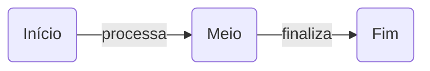

# mermaid-draw

Editor de diagramas [Mermaid](https://mermaid.js.org/) minimalista, focado em **lazy loading**: o diagrama é carregado e renderizado de forma dinâmica, sob demanda, à medida que você edita.

> 🚧 Projeto em estágio inicial: o editor com drag and drop já funciona; o lazy loading ainda não foi implementado.

## Ideia

A maioria dos editores Mermaid carrega a biblioteca inteira de uma vez e re-renderiza todo o diagrama a cada tecla. O `mermaid-draw` segue outro caminho:

- **Mermaid sob demanda** — a biblioteca só é importada (`import()` dinâmico) quando há algo para desenhar.
- **Renderização dinâmica** — o diagrama é atualizado conforme você edita, sem recarregar a página.
- **Escopo pequeno de propósito** — apenas dois componentes, para manter o editor leve e previsível.

## Componentes

O editor suporta somente dois elementos:

| Componente | Descrição | Sintaxe Mermaid |
|---|---|---|
| **Retângulo** | Caixa com cantos arredondados e um texto | `A(Texto do retângulo)` |
| **Seta** | Ligação entre dois retângulos, com um texto | `A -->\|texto da seta\| B` |

### Exemplo



## Como usar

```bash
npm install
npm run dev
```

- **Retângulo:** arraste da paleta para o canvas (ou clique nele, ou dê duplo clique no canvas vazio).
- **Seta:** arraste a bolinha azul na lateral de um retângulo até outro, ou solte a "Seta" da paleta sobre o retângulo de origem e clique no destino. Clicar em "Seta" ativa o modo seta.
- **Texto:** duplo clique no retângulo ou na seta. `Enter` confirma, `Esc` cancela.
- **Mover:** arraste o retângulo.
- **Remover:** selecione e aperte `Delete`.

O código Mermaid ao lado é atualizado enquanto você desenha, e editar o código também atualiza o canvas. As posições ficam em comentários `%% @pos id x y`, que o Mermaid ignora. O diagrama é salvo no `localStorage` do navegador.

## Roadmap

- [x] Canvas com drag and drop
- [x] Retângulo arredondado com texto
- [x] Seta com texto
- [x] Código Mermaid sincronizado nos dois sentidos, com preview
- [ ] Carregamento lazy do Mermaid
- [ ] Exportar SVG/PNG

## Licença

MIT
