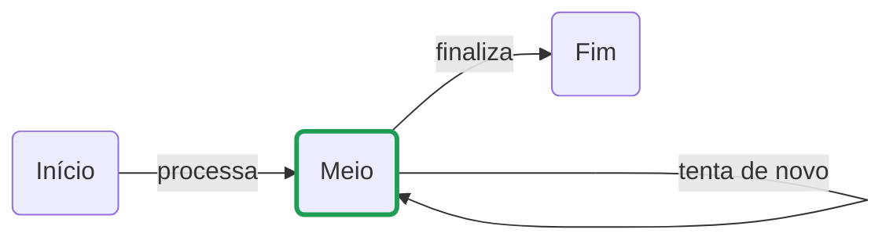

# mermaid-draw

Editor visual de diagramas [Mermaid](https://mermaid.js.org/), minimalista, com drag and drop e **fine-grained reactivity**: cada retângulo e cada seta é uma unidade independente, que pode ser criada, editada ou removida sozinha — pelo canvas ou via `curl` — sem reenviar nem redesenhar o diagrama inteiro.

> 🚧 Projeto em estágio inicial.

## Fine-grained reactivity

Em vez de tratar o diagrama como um bloco de texto Mermaid que é reescrito a cada mudança, o `mermaid-draw` trata cada elemento como um recurso próprio:

- **Na API**, um `PATCH /api/nodes/n1` altera só o retângulo `n1`. O servidor guarda o estado estruturado (JSON) e gera o código Mermaid só quando alguém pede.
- **Na rede**, cada mudança vira um evento pequeno (`node.updated`, `edge.added`…) enviado por Server-Sent Events a todas as abas abertas. Arrastar um retângulo manda só `{x, y}` daquele retângulo.
- **No canvas**, cada evento redesenha só o elemento afetado. Mudar o texto ou o status de um retângulo recria só ele; as setas ligadas a ele só são redesenhadas quando ele muda de posição ou de largura.

O código Mermaid e o preview continuam disponíveis como **visões derivadas** do estado.

## Componentes

O editor tem só dois elementos, de propósito:

| Componente | Descrição | Sintaxe Mermaid |
|---|---|---|
| **Retângulo** | Caixa com cantos arredondados e um texto. Pode estar **ativo** (borda verde) ou inativo e ter um **responsável**: o nome de quem cuida daquela etapa. | `n1("Texto")` |
| **Seta** | Liga dois retângulos, com um texto opcional. Pode ligar um retângulo a ele mesmo (ciclo). | `n1 -->\|"texto"\| n2` |

### Exemplo



## Como usar

```bash
npm install
npm run dev
```

Abra o endereço que o Vite mostrar (normalmente http://localhost:5173; se a porta estiver ocupada, ele usa a próxima).

| Ação | Como fazer |
|---|---|
| Criar retângulo | Arraste "Retângulo" da paleta para o canvas, clique nele na paleta ou dê duplo clique no canvas vazio |
| Criar seta | Arraste a bolinha azul na lateral de um retângulo até outro, ou solte "Seta" da paleta sobre o retângulo de origem e clique no destino |
| Modo seta | Clique em "Seta" na paleta: arrastar a partir de qualquer retângulo cria setas. `Esc` sai do modo |
| Criar ciclo | Arraste a bolinha para fora e volte ao mesmo retângulo, ou solte "Seta" sobre ele e clique nele mesmo |
| Editar texto | Duplo clique no retângulo ou na seta. `Enter` confirma, `Esc` cancela |
| Ativar/inativar | Clique na bolinha à esquerda do retângulo, ou selecione e aperte `A` |
| Definir o responsável | Selecione o retângulo e clique em "+ responsável", ou aperte `R`. O nome aparece numa segunda linha dentro do retângulo, no canvas e no preview |
| Trocar ou remover o responsável | Duplo clique na linha do nome (ou `R`). Esvaziar o campo remove o responsável |
| Mover | Arraste o retângulo |
| Remover | Selecione e aperte `Delete` |

O painel da direita mostra o código Mermaid, que pode ser editado, e um preview renderizado pelo próprio Mermaid. O preview usa o layout automático do Mermaid, não as posições do canvas. Editar o código é a única ação que troca o diagrama inteiro de uma vez.

### Como o diagrama é salvo

- **Fonte de verdade:** com o servidor rodando, o estado fica em `diagram.json` (fora do git), com um número de revisão (`rev`) que sobe a cada mudança. Um `diagram.mmd` do formato antigo é migrado automaticamente.
- **Ids estáveis:** retângulos e setas têm ids fixos. Os criados no navegador recebem um id aleatório curto (ex.: `n7k2q`) para não colidir entre abas; os criados via API sem id seguem a sequência (`n4`, `e3`).
- **No código Mermaid:** o status vira uma classe (`classDef ativo …` e `class n1,n2 ativo`) e as posições ficam em comentários `%% @pos id x y`, que o Mermaid ignora. O responsável vai **dentro do texto do retângulo**, numa segunda linha, para aparecer também no desenho do Mermaid:

  ```
  n2("Meio<br/><small>👤 Maria Souza</small>")
  ```

  Dá para escrever isso à mão no painel de código, e o canvas acompanha. `<`, `>` e aspas no texto são guardados como `#lt;`, `#gt;` e `#quot;`. O formato antigo, com um comentário `%% @owner n2 Maria Souza`, ainda é lido.
- **Sem servidor:** o editor continua funcionando com uma cópia no `localStorage` do navegador.

## API (curl)

O servidor do Vite (`npm run dev` ou `npm run preview`) expõe a API em `/api`. O corpo de `POST`/`PATCH` é JSON. Nas rotas de retângulo, `:ref` é o id (`n1`) ou o texto (sem diferenciar maiúsculas); em `from`/`to` das setas vale o mesmo.

```bash
# retângulos
curl -X POST  localhost:5173/api/nodes      -d '{"text":"Novo","x":200,"y":150}'
curl -X PATCH localhost:5173/api/nodes/n1   -d '{"text":"Começo"}'
curl -X PATCH localhost:5173/api/nodes/Meio -d '{"active":true,"owner":"Maria Souza"}'
curl -X PATCH localhost:5173/api/nodes/Meio -d '{"owner":null}'      # remove o responsável
curl -X DELETE localhost:5173/api/nodes/n3

# atalhos de status
curl -X POST localhost:5173/api/nodes/n1/ativar
curl -X POST localhost:5173/api/nodes/n1/desativar
curl -X POST localhost:5173/api/nodes/n1/alternar

# setas (from === to cria um ciclo)
curl -X POST  localhost:5173/api/edges    -d '{"from":"Início","to":"Meio","text":"processa"}'
curl -X PATCH localhost:5173/api/edges/e1 -d '{"text":"vai"}'
curl -X DELETE localhost:5173/api/edges/e1

# diagrama inteiro
curl localhost:5173/api/diagram                                   # código Mermaid
curl localhost:5173/api/diagram.json                              # {rev, diagram}
curl -X PUT --data-binary @meu.mmd localhost:5173/api/diagram     # substitui tudo
```

| Método | Rota | O que faz |
|---|---|---|
| `GET` | `/api/nodes` | Lista os retângulos (`id`, `text`, `active`, `owner`, `x`, `y`). `owner` é `null` quando não há responsável |
| `POST` | `/api/nodes` | Cria: `{text?, x?, y?, active?, owner?, id?}` → `201`. Sem `x`/`y`, vai para uma vaga livre |
| `GET` | `/api/nodes/:ref` | Um retângulo |
| `PATCH` | `/api/nodes/:ref` | Altera só os campos enviados: `{text?, x?, y?, active?, owner?}`. `owner` vazio ou `null` remove o responsável; o nome tem até 60 caracteres, em uma linha |
| `DELETE` | `/api/nodes/:ref` | Remove o retângulo e as setas ligadas a ele |
| `POST` | `/api/nodes/:ref/ativar` · `desativar` · `alternar` | Atalhos para o status |
| `GET` | `/api/edges` | Lista as setas (`id`, `from`, `to`, `text`) |
| `POST` | `/api/edges` | Cria: `{from, to, text?, id?}` → `201` |
| `GET` | `/api/edges/:id` | Uma seta |
| `PATCH` | `/api/edges/:id` | Altera `{text?, from?, to?}` |
| `DELETE` | `/api/edges/:id` | Remove |
| `GET` | `/api/diagram` | Código Mermaid gerado na hora (`204` se ainda não há diagrama) |
| `PUT` | `/api/diagram` | Substitui tudo a partir de código Mermaid (mantém os ids das setas que continuam iguais) |
| `GET` | `/api/diagram.json` | Estado completo: `{rev, diagram}` |
| `PUT` | `/api/diagram.json` | Substitui tudo a partir de `{nodes, edges}` |
| `GET` | `/api/events` | Server-Sent Events: um `snapshot` ao conectar e depois um evento por mudança |

Toda resposta traz o cabeçalho `X-Rev` com a revisão atual. Erros: `400` (campo ou JSON inválido), `404` (elemento não existe), `409` (id repetido, seta duplicada ou texto que corresponde a mais de um retângulo — use o id).

### Eventos

Cada evento traz `rev` e `source` (quem fez a mudança: o id da aba ou `api`). Se uma aba perceber um salto em `rev`, ela recarrega o estado com `GET /api/diagram.json`.

```json
{ "type": "node.updated", "node": { "id": "n2", "text": "Meio", "x": 333, "y": 100 }, "rev": 7, "source": "api" }
```

| Tipo | Conteúdo |
|---|---|
| `snapshot` | `diagram` inteiro (ou `null`), enviado ao conectar |
| `node.added` · `node.updated` | `node` |
| `node.removed` | `id` e `edges` (ids das setas removidas junto) |
| `edge.added` · `edge.updated` | `edge` |
| `edge.removed` | `id` |
| `diagram.replaced` | `diagram` inteiro (após um `PUT`) |

### Variáveis de ambiente

| Variável | Para quê |
|---|---|
| `MERMAID_DRAW_FILE` | Arquivo onde a API guarda o estado (padrão: `diagram.json` na raiz do projeto) |

No WSL, o Vite usa polling automaticamente para perceber mudanças em arquivos de `/mnt/c`.

## Desenvolvimento

```bash
npm test          # testes (vitest): operações e API
npm run build     # checagem de tipos + build
```

```
index.html         layout da página
src/model.ts       modelo do diagrama, geração e leitura do código Mermaid
src/ops.ts         operações granulares (criar/alterar/remover) e seus eventos — usadas no navegador e no servidor
src/store.ts       estado no navegador (diagrama, seleção, modo); avisa exatamente o que mudou
src/canvas.ts      canvas SVG: drag and drop, setas, ciclos, edição de texto; redesenha só o elemento afetado
src/sync.ts        sincronização com a API: uma requisição por mudança, eventos do servidor aplicados um a um
src/main.ts        paleta, painel de código, preview
src/style.css      estilos (tema claro e escuro)
server/api.ts      plugin do Vite com a API HTTP e os Server-Sent Events
```

## Roadmap

- [x] Canvas com drag and drop
- [x] Retângulo arredondado com texto
- [x] Seta com texto, incluindo ciclos
- [x] Código Mermaid sincronizado nos dois sentidos, com preview
- [x] Status ativo/inativo, com responsável pela etapa
- [x] Fine-grained reactivity: API e sincronização por elemento, canvas redesenhando só o que mudou
- [ ] Exportar SVG/PNG

## Licença

MIT
